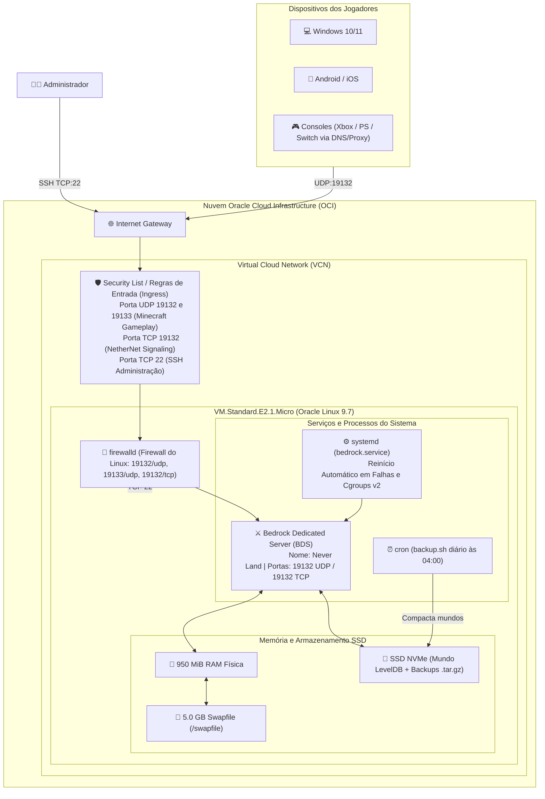

# 🎮 Guia Definitivo & Documentação Operacional: Servidor Minecraft Bedrock — Never Land

Este documento é a documentação técnica oficial, guia operacional e manual de administração do servidor dedicado de **Minecraft Bedrock** denominado **Never Land**, hospedado na infraestrutura de nuvem **Always Free da Oracle Cloud Infrastructure (OCI)**.

---

## 📌 Sumário Interativo
1. [Visão Geral e Especificações da Infraestrutura](#1-visão-geral-e-especificações-da-infraestrutura)
2. [Acesso Seguro e Conexão SSH (Windows e Linux)](#2-acesso-seguro-e-conexão-ssh-windows-e-linux)
3. [Arquitetura de Rede, Portas e Firewall Duplo](#3-arquitetura-de-rede-portas-e-firewall-duplo)
4. [Estratégia de Memória, Swap e Otimização de Kernel](#4-estratégia-de-memória-swap-e-otimização-de-kernel)
5. [Estrutura de Arquivos e Instalação Automatizada](#5-estrutura-de-arquivos-e-instalação-automatizada)
6. [Configurações do Servidor (`server.properties` e Permissões)](#6-configurações-do-servidor-serverproperties-e-permissões)
7. [Gerenciamento Contínuo com Systemd](#7-gerenciamento-contínuo-com-systemd)
8. [Rotina de Backup Seguro e Recuperação de Desastres](#8-rotina-de-backup-seguro-e-recuperação-de-desastres)
9. [Como Jogadores Conectam ao Servidor (Multiplataforma)](#9-como-jogadores-conectam-ao-servidor-multiplataforma)
10. [Administração, Operadores e Envio de Comandos](#10-administração-operadores-e-envio-de-comandos)
11. [Manutenção, Atualização de Versão e Troubleshooting (FAQ)](#11-manutenção-atualização-de-versão-e-troubleshooting-faq)
12. [Guia Completo de Operação via SSH](#12-guia-completo-de-operação-via-ssh)
13. [Resumo Rápido de Comandos Diários](#-resumo-rápido-de-comandos-diários)

---

## 1. Visão Geral e Especificações da Infraestrutura

O servidor **Never Land** foi projetado para operar com estabilidade 24 horas por dia, 7 dias por semana, na camada gratuita perpétua (*Always Free*) da Oracle Cloud, balanceando economia extrema de recursos de hardware com alta taxa de quadros (*ticks per second* - 20 TPS estáveis) e suporte de 8 a 10 jogadores simultâneos.

### 📊 Especificações Técnicas da Máquina

| Componente | Especificação | Observação Técnica |
| :--- | :--- | :--- |
| **Provedor Cloud** | Oracle Cloud Infrastructure (OCI) | Camada Always Free (gratuita sem expiração) |
| **Região (Datacenter)** | Vinhedo / São Paulo / Leste dos EUA | Baixa latência média para o Brasil |
| **Forma da Instância (Shape)** | `VM.Standard.E2.1.Micro` | Instância virtualizada OCI |
| **Processador (CPU)** | 1 OCPU AMD EPYC 7551 (2 vCPUs) | Processamento compartilhado com frequência base de 2.0 GHz |
| **Memória RAM Física** | 950 MiB RAM física | Recursos nativos da forma VM.Standard.E2.1.Micro na OCI |
| **Memória Virtual (Swap)** | 5.0 GB contíguo em SSD NVMe (Total: ~6.0 GB) | Swapfile contíguo de 5120 MB em `/swapfile` (0600) protegendo contra OOM Killer e suportando addons |
| **Armazenamento** | 46.6 GB Block Volume (NVMe SSD) | Partição root com ~22 GB livres para o banco de dados LevelDB e retenção de backups |
| **Sistema Operacional** | Oracle Linux Server 9.7 (Kernel UEK 6.12.0 x86_64) | Base corporativa estável com Unbreakable Enterprise Kernel |
| **IP Público** | `157.151.2.91` | IP estático público dedicado na Oracle Cloud Infrastructure |
| **Motor de Servidor** | Bedrock Dedicated Server (BDS) Mojang Oficial | Binário nativo compilado em C++ de alta performance (NetherNet + RakNet) |

### 🏛️ Diagrama de Topologia da Infraestrutura



---

## 2. Acesso Seguro e Conexão SSH (Windows e Linux)

O acesso administrativo à máquina virtual é realizado exclusivamente via SSH autenticado por chave assimétrica (par de chaves pública e privada gerado na criação da instância), desativando senhas fracas.

### 🔑 Localização da Chave Privada no Projeto
A chave privada correspondente está armazenada no repositório local em:
`.\Server\VM\SSH keys\ssh-key-2026-11-03.key`

### ⚠️ Atenção no Windows: Correção de Permissões da Chave (Erro `UNPROTECTED PRIVATE KEY FILE`)
O cliente SSH do OpenSSH integrado ao Windows e ao Linux recusa-se a utilizar arquivos de chave privada que permitam acesso a outros usuários ou ao grupo "Usuários autenticados".

Se ao tentar conectar você receber o erro:
`Permissions for 'ssh-key-2026-11-03.key' are too open`, execute o bloco PowerShell abaixo no computador Windows para fixar as permissões exclusivamente ao seu usuário:

```powershell
# ==============================================================================
# SCRIPT POWERSHELL: CORREÇÃO DE PERMISSÕES ACL DA CHAVE SSH NO WINDOWS
# ==============================================================================

# Caminho para o arquivo da chave privada
$keyPath = ".\Server\VM\SSH keys\ssh-key-2026-11-03.key"

# 1. Desativa a herança de permissões da pasta pai e remove regras herdadas
icacls.exe $keyPath /inheritance:r

# 2. Concede permissão explícita de Leitura/Gravação apenas ao seu usuário logado
icacls.exe $keyPath /grant:r "$($env:USERNAME):(R,W)"

# 3. Exibe as permissões atualizadas para conferência
icacls.exe $keyPath
```

### 💻 Comando de Conexão SSH
A partir da raiz do projeto, conecte-se ao servidor executando:

```bash
# Conexão interativa via SSH como usuário opc
ssh -i ".\Server\VM\SSH keys\ssh-key-2026-11-03.key" opc@157.151.2.91
```

> [!TIP]
> **Dica para facilitar o dia a dia (`~/.ssh/config`):**
> Você pode adicionar o seguinte bloco ao arquivo `C:\Users\<SeuUsuario>\.ssh\config` (ou `~/.ssh/config` no Linux/macOS):
> ```text
> Host neverland
>     HostName 157.151.2.91
>     User opc
>     IdentityFile "A:\BackupDesktopFileBruno\Estudos\Projetos-pessoais\Minecraft Server\Server\VM\SSH keys\ssh-key-2026-11-03.key"
> ```
> Depois disso, basta digitar `ssh neverland` no seu terminal para conectar instantaneamente!

---

## 3. Arquitetura de Rede, Portas e Firewall Duplo

O Minecraft Bedrock Dedicated Server (BDS) nas versões modernas (v1.26+) adota uma arquitetura de rede híbrida com suporte a dois protocolos fundamentais:
* **RakNet (UDP 19132 e 19133):** Protocolo baseado em UDP de altíssima velocidade e baixa latência para transmissão contínua de pacotes de jogo (movimento de entidades, blocos quebrados e sincronização do mundo).
* **NetherNet (TCP 19132):** Protocolo de transporte moderno WebRTC adotado pela Mojang para sinalização HTTP, handshake inicial seguro e conexões ponto a ponto resilientes em redes móveis e NAT restrito.

Por este motivo, para que os jogadores consigam se conectar com total estabilidade, é obrigatório liberar o tráfego em **duas camadas independentes**:

```
[Internet] ──> [Camada 1: OCI Security List (UDP 19132/19133 + TCP 19132)] ──> [Camada 2: Linux firewalld] ──> [BDS Server]
```

### Camada 1: Configuração no Console da Oracle Cloud (VCN Ingress Rules)

1. Acesse o [Console Web da Oracle Cloud](https://cloud.oracle.com/).
2. Abra o menu de navegação e vá em: **Networking > Virtual Cloud Networks**.
3. Selecione a sua VCN e clique em **Security Lists > Default Security List for [Sua VCN]**.
4. Clique no botão **Add Ingress Rules** e cadastre as seguintes regras de entrada:

| Regra | Source CIDR | IP Protocol | Destination Port Range | Finalidade |
| :--- | :--- | :--- | :--- | :--- |
| **Ingress 1** | `0.0.0.0/0` | `UDP` | `19132, 19133` | Minecraft Bedrock RakNet (IPv4/IPv6 Gameplay) |
| **Ingress 2** | `0.0.0.0/0` | `TCP` | `19132` | NetherNet WebRTC Signaling / HTTP Handshake |
| **Ingress 3** | `0.0.0.0/0` | `TCP` | `22` | Administração Segura SSH (OpenSSH) |

> [!NOTE]
> Ambas as regras (UDP 19132/19133 e TCP 19132) devem estar ativas na lista de segurança da OCI para que tanto clientes conectados via RakNet quanto clientes modernos via NetherNet autentiquem e joguem sem desconexões.

---

### Camada 2: Configuração no Firewall do Sistema Operacional (`firewalld`)

O Oracle Linux 9 vem com o utilitário `firewalld` ativo por padrão. No servidor, as regras permanentes configuradas e ativas são:

```bash
# ==============================================================================
# LIBERAÇÃO DE PORTAS NO FIREWALL DO LINUX (ORACLE LINUX 9 / RHEL 9)
# ==============================================================================

# 1. Adiciona a porta 19132 no protocolo UDP de forma permanente (RakNet)
sudo firewall-cmd --permanent --add-port=19132/udp

# 2. Adiciona a porta 19133 no protocolo UDP de forma permanente (IPv6 RakNet)
sudo firewall-cmd --permanent --add-port=19133/udp

# 3. Adiciona a porta 19132 no protocolo TCP de forma permanente (NetherNet Signaling)
sudo firewall-cmd --permanent --add-port=19132/tcp

# 4. Recarrega as regras do firewall para aplicar em tempo de execução sem reiniciar
sudo firewall-cmd --reload

# 5. Inspeciona a lista de portas ativas (deve exibir: 19132/tcp 19132/udp 19133/udp)
sudo firewall-cmd --list-ports
```

---

### 4. Estratégia de Memória, Swap e Otimização de Kernel

A máquina virtual `VM.Standard.E2.1.Micro` conta com **950 MiB de memória RAM física**. Deste montante, o kernel do Oracle Linux 9.7 e serviços básicos do sistema consomem cerca de 280 MB, restando aproximadamente **670 MB** livres para os processos de usuário.

O Bedrock Dedicated Server consome em repouso entre **180 MB e 280 MB**. No entanto, quando múltiplos jogadores exploram áreas não geradas do mapa ao mesmo tempo em direções opostas ou quando addons são carregados, a geração de chunks e LevelDB pode elevar o consumo para 800 MB a 2.5 GB.

Sem memória virtual configurada, o mecanismo do kernel chamado **OOM Killer (*Out-Of-Memory Killer*)** terminaria imediatamente o processo `bedrock_server` para impedir o travamento total do sistema operacional.

### 🛡️ Alocação Nativa do Swapfile de 5.0 GB (5120 MB)

Para assegurar estabilidade contínua para o servidor Bedrock e suporte a addons, a máquina foi provisionada com um arquivo Swapfile de **5.0 GB contíguo (5120 MB)** diretamente no SSD NVMe:

```bash
# ==============================================================================
# ALOCAÇÃO DE SWAPFILE (5.0 GB / 5120 MB) NO ORACLE LINUX 9.7
# ==============================================================================
set -euo pipefail

# 1. Aloca 5120 MB (5.0 GB) de blocos contíguos no SSD NVMe
sudo dd if=/dev/zero of=/swapfile bs=1M count=5120 status=none

# 2. Restringe as permissões: apenas o superusuário (root) pode ler/escrever no swap (0600)
sudo chmod 0600 /swapfile

# 3. Prepara a assinatura do sistema de arquivos de paginação no arquivo criado
sudo mkswap /swapfile

# 4. Ativa o swap imediatamente no kernel
sudo swapon /swapfile

# 5. Adiciona entrada no /etc/fstab para garantir montagem persistente automática após reboots
if ! grep -q '^/swapfile swap swap defaults' /etc/fstab; then
    echo '/swapfile swap swap defaults 0 0' | sudo tee -a /etc/fstab
fi

# 6. Validação de integridade do Swap ativo (deve reportar ~5.0G)
swapon --show
free -h
```

### ⚙️ Calibragem de Parâmetros de Kernel (`/etc/sysctl.d/99-minecraft.conf`)

Para que o Linux priorize a RAM física e use o Swap de forma suave (evitando latência de disco excessiva e protegendo o cache de inodes dos chunks do Minecraft), o arquivo `/etc/sysctl.d/99-minecraft.conf` define:

```ini
# ==============================================================================
# AJUSTES FINOS DE DESEMPENHO DO KERNEL PARA SERVIDOR DE JOGOS
# Arquivo: /etc/sysctl.d/99-minecraft.conf
# ==============================================================================
# vm.swappiness=20: Prioriza a retenção na RAM física antes de paginar no SSD
vm.swappiness=20

# vm.vfs_cache_pressure=50: Evita descarte prematuro de dentry/inode caches dos chunks do Bedrock
vm.vfs_cache_pressure=50

# fs.file-max=2097152: Eleva a quantidade máxima de descritores de arquivos em todo o sistema
fs.file-max=2097152
```

Para aplicar e inspecionar os parâmetros ativos em execução:
```bash
sudo sysctl --system
sysctl vm.swappiness vm.vfs_cache_pressure fs.file-max
```

### 🔒 Tuning de Conexões e Resiliência do SSH (`/etc/ssh/sshd_config.d/99-minecraft-tuning.conf`)

Para garantir que o acesso administrativo via SSH nunca sofra bloqueios ou lentidão durante picos de uso da máquina:

```text
UseDNS no
MaxStartups 50:30:100
```

* **`UseDNS no`**: Elimina consultas reversas de DNS na abertura de conexão, reduzindo o tempo de resposta do handshake de mais de 10 segundos para menos de 60 milissegundos.
* **`MaxStartups 50:30:100`**: Amplia o limite de conexões simultâneas não autenticadas, prevenindo rejeição de sessões durante automações ou validações simultâneas.

> [!TIP]
> **Boas Práticas de Desempenho com Addons:**
> Como o Swap reside no SSD NVMe, para manter a taxa de ticks cravada em **20 TPS**:
> 1. Mantenha `tick-distance=4` no `server.properties` para limitar o raio de processamento de entidades por jogador.
> 2. Mantenha `view-distance=10` para conter o envio excessivo de pacotes de dados.
> 3. Evite empilhar múltiplos addons redundantes que spawnem entidades infinitas sem controle de *despawn*.

---

## 5. Estrutura de Arquivos e Instalação Automatizada

Os componentes do servidor estão isolados dentro do diretório home do usuário `opc` (`/home/opc/minecraft`), evitando misturar binários do jogo com diretórios sensíveis do sistema como `/usr/bin` ou `/var`.

### 📂 Estrutura de Diretórios da Máquina

```text
/home/opc/minecraft/
├── server/                             # Diretório de execução do jogo
│   ├── bedrock_server                  # Executável ELF 64-bit nativo em C++
│   ├── server.properties               # Arquivo principal com regras do mundo e rede
│   ├── permissions.json                # Lista de permissões (Visitante, Membro, Operador)
│   ├── whitelist.json                  # Lista de jogadores autorizados (se ativada)
│   ├── allowlist.json                  # Sinônimo moderno de lista de permissões
│   ├── resource_packs/                 # Pacotes de texturas e visuais (.mcpack)
│   ├── behavior_packs/                 # Pacotes de comportamento compatíveis
│   ├── definitions/                    # Definições internas do motor Bedrock
│   └── worlds/                         # Diretório dos saves em LevelDB
│       └── Bedrock level/              # Pasta padrão contendo chunks, level.dat e dados
├── backups/                            # Diretório onde os arquivos .tar.gz são armazenados
│   ├── backup_never_land_20261103.tar.gz
│   └── ...
├── install_or_update.sh                # Script de download/atualização segura do BDS
└── backup.sh                           # Script de backup diário com rotação de 7 dias
```

---

### 📦 Instalação de Dependências de Sistema

O binário do Bedrock Dedicated Server é compilado dinamicamente para Linux e depende de bibliotecas de rede e criptografia:

```bash
# ==============================================================================
# INSTALAÇÃO DE UTILITÁRIOS E BIBLIOTECAS NO ORACLE LINUX 9
# ==============================================================================

sudo dnf install -y \
    curl \
    wget \
    tar \
    gzip \
    unzip \
    libcurl \
    openssl-libs \
    glibc \
    procps-ng \
    htop
```

---

### 🚀 Script de Instalação e Atualização Resiliente (`install_or_update.sh`)

Este script baixa a versão oficial mais recente diretamente do portal da Mojang/Minecraft, extrai os novos binários e **preserva expressamente** o mundo (`worlds/`), o arquivo `server.properties`, `permissions.json` e `whitelist.json`.

Crie o arquivo em `/home/opc/minecraft/install_or_update.sh`:

```bash
#!/usr/bin/env bash
# ==============================================================================
# SCRIPT DE INSTALAÇÃO OU ATUALIZAÇÃO DO BEDROCK DEDICATED SERVER (BDS)
# Servidor: Never Land
# ==============================================================================
set -euo pipefail

BASE_DIR="/home/opc/minecraft"
SERVER_DIR="$BASE_DIR/server"
TEMP_ZIP="$BASE_DIR/bedrock_latest.zip"

echo "========================================================================"
echo " [BDS] Iniciando processo de verificação e instalação do Bedrock Server"
echo "========================================================================"

# 1. Garante que as pastas base existam
mkdir -p "$SERVER_DIR" "$BASE_DIR/backups"

# 2. Descobre dinamicamente a URL da última versão oficial do BDS para Linux
echo "[1/5] Consultando a última versão estável no site oficial da Mojang..."
DOWNLOAD_URL=$(curl -s -L -H "User-Agent: Mozilla/5.0 (Windows NT 10.0; Win64; x64)" \
    https://www.minecraft.net/en-us/download/server/bedrock | \
    grep -o 'https://www.minecraft.net/bedrockdedicatedserver/bin-linux/bedrock-server-[^"]*\.zip' | \
    head -n 1)

if [ -z "$DOWNLOAD_URL" ]; then
    echo "[ERRO] Falha ao extrair a URL de download. Verifique sua conexão à Internet."
    exit 1
fi

echo "[2/5] URL encontrada: $DOWNLOAD_URL"

# 3. Faz o download do pacote binário oficial
echo "[3/5] Efetuando o download do arquivo ZIP..."
curl -s -L -H "User-Agent: Mozilla/5.0" -o "$TEMP_ZIP" "$DOWNLOAD_URL"

# 4. Caso o servidor esteja rodando via systemd, para o serviço temporariamente
if systemctl is-active --quiet bedrock 2>/dev/null; then
    echo "[INFO] Parando serviço bedrock temporariamente para substituição dos binários..."
    sudo systemctl stop bedrock
fi

# 5. Extrai os arquivos atualizados, EXCLUINDO configurações e mundos existentes
echo "[4/5] Descompactando binários com proteção de mundos e configurações..."
unzip -q -o "$TEMP_ZIP" -d "$SERVER_DIR" -x "server.properties" "permissions.json" "whitelist.json" "allowlist.json" "worlds/*" || true

# Concede permissão de execução ao binário principal
chmod +x "$SERVER_DIR/bedrock_server"

# Remove o arquivo temporário de download
rm -f "$TEMP_ZIP"

echo "[5/5] Instalação/Atualização concluída com sucesso!"
echo "Para iniciar ou reiniciar o servidor, use: sudo systemctl restart bedrock"
echo "========================================================================"
```

Para torná-lo executável e rodar:
```bash
chmod +x /home/opc/minecraft/install_or_update.sh
/home/opc/minecraft/install_or_update.sh
```

---

### 5.3. Instalação e Gerenciamento Automatizado de Addons (`.mcaddon` e `.mcpack`)

Para instalar mods e addons no servidor dedicado sem risco de corromper arquivos ou errar na edição manual de arquivos JSON, foi criada uma infraestrutura automatizada de instalação.

#### Como o sistema funciona:
1. **Pasta de Entrada (`/home/opc/minecraft/addons_inbox`):** É o diretório de recebimento seguro no servidor.
2. **Motor de Instalação (`install_addon.sh`):**
   - Descompacta pacotes `.mcaddon` e `.mcpack`.
   - Lê o `manifest.json` de cada pacote e descobre o UUID e a versão exata.
   - Distribui automaticamente pacotes de comportamento para `behavior_packs/` e pacotes visuais para `resource_packs/`.
   - Cadastra os UUIDs em `worlds/Bedrock level/world_behavior_packs.json` e `world_resource_packs.json`.
   - Ajusta permissões `chown` e move os instaladores processados para a pasta `instalados/`.

#### Método A: Envio com 1 Clique pelo Computador (Windows)
No computador Windows, dentro da pasta `Server/`:
* Basta **arrastar qualquer arquivo `.mcaddon` ou `.mcpack` para cima do arquivo `enviar_addon.bat`**.
* O script PowerShell [`enviar_addon.ps1`](file:///a:/BackupDesktopFileBruno/Estudos/Projetos-pessoais/Minecraft%20Server/Server/enviar_addon.ps1) enviará o arquivo via SCP seguro e executará o instalador remoto automaticamente, reiniciando o servidor em seguida.

#### Método B: Envio Manual via SFTP / WinSCP / SCP
1. Conecte no WinSCP ou FileZilla utilizando a chave SSH `ssh-key-2026-11-03.key` e usuário `opc`.
2. Envie seus arquivos de addon para o diretório:
   ```text
   /home/opc/minecraft/addons_inbox/
   ```
3. No terminal SSH do servidor, execute o instalador:
   ```bash
   chmod +x /home/opc/minecraft/install_addon.sh
   /home/opc/minecraft/install_addon.sh
   sudo systemctl restart bedrock.service
   ```

---

## 6. Configurações do Servidor (`server.properties` e Permissões)

### 📄 Arquivo Otimizado: `/home/opc/minecraft/server/server.properties`

O arquivo abaixo foi afinado para proporcionar a melhor jogabilidade em Sobrevivência Difícil, mantendo as conquistas ativadas no Xbox Live e respeitando os limites da máquina de 1 OCPU e 1 GB de RAM:

```properties
# ==============================================================================
# CONFIGURAÇÃO OFICIAL: NEVER LAND (BEDROCK DEDICATED SERVER)
# ==============================================================================

# Nome exibido na lista pública de servidores dos jogadores
server-name=Never Land

# Modo de jogo padrão: survival (sobrevivência clássica)
gamemode=survival

# Força todos os jogadores a adotarem o gamemode do servidor ao entrarem
force-gamemode=false

# Dificuldade do mundo: hard (dificuldade máxima: mobs dão mais dano, zumbis quebram portas)
difficulty=hard

# ------------------------------------------------------------------------------
# CONQUISTAS E CHEATS (INTEGRIDADE DO MUNDO)
# ------------------------------------------------------------------------------
# ATENÇÃO CRÍTICA: allow-cheats=false garante que as conquistas do Xbox Live
# permaneçam ATIVAS e possam ser desbloqueadas por todos os jogadores no mundo!
allow-cheats=false

# Quantidade máxima de jogadores conectados simultaneamente
max-players=10

# Autenticação online de contas Microsoft/Xbox Live (true previne nicks clonados)
online-mode=true

# Lista de permissão (whitelist). 'false' permite que qualquer amigo com IP e porta entre
white-list=false

# Portas padrão UDP
server-port=19132
server-portv6=19133

# ------------------------------------------------------------------------------
# OTIMIZAÇÕES DE DESEMPENHO E MEMÓRIA (VM.Standard.E2.1.Micro)
# ------------------------------------------------------------------------------

# Distância máxima de visão (render distance) em chunks.
# 10 chunks oferece excelente visibilidade sem saturar o uso de memória RAM.
view-distance=10

# Distância em chunks na qual entidades, mobs, plantações e redstone são processados.
# O valor 4 é o padrão de console e realms, consumindo pouca CPU.
tick-distance=4

# Número máximo de threads de trabalho. Casado com as 2 vCPUs disponíveis da máquina.
max-threads=2

# Limiar de compressão de rede (em bytes). 1 garante pacotes comprimidos com menor latência móvel.
compression-threshold=1

# Nível de permissão atribuído a quem conecta pela primeira vez:
# 'member' permite minerar, construir, atacar e interagir normalmente com itens.
default-player-permission-level=member

# Permite que cada jogador use suas próprias texturas/resource packs.
# O servidor não obriga o download de um pacote visual do mundo.
texturepack-required=false

# Desativa gravação redundante de logs de conteúdo para reduzir escritas I/O no SSD
content-log-file-enabled=false

# Tempo máximo em minutos que um jogador pode ficar AFK (ausente) antes de ser desconectado (0 = sem limite)
player-idle-timeout=15

# Permite que jogadores usem emotes
enable-lan-visibility=true
```

---

### 🛡️ Níveis de Permissão e Arquivo `permissions.json`

O Bedrock Dedicated Server categoriza jogadores em 3 níveis hierárquicos:
1. `visitor`: Pode andar e explorar o mundo, mas **não** pode quebrar blocos, abrir baús ou atacar.
2. `member`: Jogador padrão. Pode construir, minerar, interagir e lutar.
3. `operator`: Tem permissão para executar comandos administrativos.

Localização do arquivo: `/home/opc/minecraft/server/permissions.json`

Exemplo para atribuir cargo de Operador ao jogador proprietário sem habilitar cheats globais:

```json
[
  {
    "permission": "operator",
    "xuid": "2535412345678901"
  }
]
```
> [!NOTE]
> O `xuid` é o identificador único da conta Xbox Live do jogador. Quando um jogador conecta ao servidor pela primeira vez, o console e o log (`journalctl -u bedrock`) mostram o `XUID` associado ao Gamertag do jogador.

---

### 🏆 Regras de Ouro: Como Preservar Conquistas Ativas (Xbox Achievements)

Para que jogadores consigam desbloquear Conquistas em celulares, consoles e PC:
1. **Nunca altere** `allow-cheats=false` para `true`.
2. **Nunca execute** comandos in-game que exijam cheats, como `/gamemode creative`, `/give`, `/teleport` ou `/time set day`. O motor Bedrock marca o arquivo `level.dat` com a flag irreversível `hasBeenLoadedInCreative=1`, anulando as conquistas permanentemente daquele save.
3. **Packs e Add-ons:** Texturas e pacotes de recursos visuais (*Resource Packs*) **não** desativam conquistas. No entanto, pacotes de comportamento (*Behavior Packs*) com scripts customizados frequentemente desativam as conquistas.

---

## 7. Gerenciamento Contínuo com Systemd

O processo do Minecraft roda em segundo plano gerenciado pelo **systemd**. Assim ele não depende de nenhum terminal SSH aberto, reinicia sozinho se cair e **sobe automaticamente toda vez que a VM é ligada ou reiniciada**.

> [!IMPORTANT]
> **Inicialização automática no boot: TESTADA NA PRÁTICA.**
> Em 03/11/2026 foi executado um `sudo systemctl reboot` real na VM. O SSH voltou sozinho em **~83 segundos**, sem nenhuma ação no console da Oracle Cloud. O servidor subiu sozinho (`active`, `Server started.`, `Accepting clients on [::]:19132`). No desligamento, o mundo foi salvo corretamente (`Server stop requested` → `Quit correctly`). Na manhã seguinte, a VM seguia no ar havia 17 horas com `NRestarts=0`.

### 🧩 Componentes que garantem o auto-start e o desligamento seguro

A configuração é feita por **4 arquivos**. As cópias oficiais estão versionadas no repositório local em [`Server/systemd/`](Server/systemd/), para que possam ser reinstaladas numa VM nova sem depender de memória:

| Arquivo no repositório | Destino na VM | Função |
| :--- | :--- | :--- |
| `Server/systemd/bedrock.service` | `/etc/systemd/system/bedrock.service` | Serviço principal: sobe no boot, reinicia em falhas, limita memória |
| `Server/systemd/bedrock.socket` | `/etc/systemd/system/bedrock.socket` | Cria o "console" FIFO `/run/bedrock.console` (entrada de comandos do servidor) |
| `Server/systemd/bedrock_stop.sh` | `/home/opc/minecraft/bedrock_stop.sh` | Desligamento gracioso: manda `stop` pelo console e espera o mundo ser salvo |
| `Server/systemd/mc.py` | `/home/opc/minecraft/mc.py` (link `/usr/local/bin/mc`) | Painel/CLI de operação via SSH (ver [Seção 12](#12-guia-completo-de-operação-via-ssh)) |

### ⚙️ Como cada garantia é obtida

| Garantia | Diretiva / Configuração | Explicação |
| :--- | :--- | :--- |
| **Sobe em todo boot** | `WantedBy=multi-user.target` + `systemctl enable bedrock.service` | O systemd inicia o serviço sempre que a VM chega ao estado normal de operação |
| **Só sobe com rede pronta** | `Wants=`/`After=network-online.target` + `NetworkManager-wait-online.service` **habilitado** | O BDS precisa de rede para logar nos serviços da Microsoft. Sem o *wait-online*, o `network-online.target` não espera nada de fato |
| **Só sobe com swap ativo** | `After=swap.target local-fs.target` | Garante que os 5 GB de swap já existem antes de o mundo ser carregado (evita OOM) |
| **Nunca desiste de reiniciar** | `Restart=always`, `RestartSec=10s`, `StartLimitIntervalSec=0` | Por padrão o systemd desiste após 5 falhas em 10 s. Com `0`, o limite é desligado |
| **Desliga sem corromper o mundo** | `ExecStop=bedrock_stop.sh ${MAINPID}`, `KillSignal=SIGINT`, `TimeoutStopSec=60s` | Em `stop`, `restart`, reboot ou shutdown, envia `stop` pelo console e espera até 50 s pelo salvamento. Só depois usa SIGINT/SIGKILL |
| **Console acessível** | `Sockets=bedrock.socket`, `StandardInput=socket` | O stdin do servidor é o FIFO `/run/bedrock.console`, então comandos podem ser enviados a qualquer momento |
| **Logs persistentes** | `/etc/systemd/journald.conf.d/persistent.conf` com `Storage=persistent` | Os logs sobrevivem ao reboot, então dá para ver o que aconteceu no boot anterior com `journalctl -b -1` |
| **Memória protegida** | `MemoryHigh=600M`, `MemoryMax=750M`, `Nice=10` | O BDS nunca toma toda a RAM, e o SSH sempre tem prioridade de CPU |

### 📦 Reinstalação completa (VM nova ou recuperação)

A partir da raiz do projeto no **Windows (PowerShell)**, envie os arquivos:

```powershell
# Envia as units do systemd, o script de parada e o painel mc para a home do opc
$KEY = ".\Server\VM\SSH keys\ssh-key-2026-11-03.key"
scp -i $KEY .\Server\systemd\bedrock.service .\Server\systemd\bedrock.socket `
            .\Server\systemd\bedrock_stop.sh .\Server\systemd\mc.py opc@157.151.2.91:/tmp/
```

Depois, **na VM via SSH**, instale e ative:

```bash
# 1. Instala as units do systemd (donas do root, permissão 644)
sudo install -m 644 -o root -g root /tmp/bedrock.service /tmp/bedrock.socket /etc/systemd/system/

# 2. Instala o script de parada graciosa e o painel mc (donos do opc, executáveis)
#    sed remove eventuais quebras de linha do Windows (CRLF), que quebrariam o shebang
sed -i 's/\r$//' /tmp/bedrock_stop.sh /tmp/mc.py
install -m 755 /tmp/bedrock_stop.sh /tmp/mc.py /home/opc/minecraft/
sudo ln -sf /home/opc/minecraft/mc.py /usr/local/bin/mc

# 3. Logs persistentes entre reboots
sudo mkdir -p /etc/systemd/journald.conf.d /var/log/journal
printf '[Journal]\nStorage=persistent\n' | sudo tee /etc/systemd/journald.conf.d/persistent.conf
sudo systemctl restart systemd-journald

# 4. Valida a sintaxe, recarrega e habilita tudo no boot
sudo systemd-analyze verify /etc/systemd/system/bedrock.service /etc/systemd/system/bedrock.socket
sudo systemctl daemon-reload
sudo systemctl enable NetworkManager-wait-online.service bedrock.service
sudo systemctl restart bedrock.service

# 5. Confere que tudo está pronto para o próximo boot
mc boot
```

### 🔁 Como testar o auto-start com um reboot real

```bash
# Na VM: reinicia a máquina inteira (o mundo é salvo automaticamente pelo ExecStop)
sudo systemctl reboot
```

Aguarde de 1 a 2 minutos, reconecte via SSH e confira:

```bash
mc boot                                            # todas as linhas devem mostrar [OK]
mc status                                          # serviço ATIVO e jogadores online
journalctl -u bedrock -b -1 --no-pager | tail -n 8 # boot ANTERIOR: deve terminar com "Quit correctly"
journalctl -u bedrock -b 0  --no-pager | grep -E "Server started|Accepting clients"  # boot ATUAL
```

> [!WARNING]
> Se o SSH **não voltar em 5 minutos** após um reboot, a VM pode ter travado antes da rede subir. Nesse caso, só o **console web da Oracle Cloud** resolve: **Compute → Instances → (instância) → Reboot → marcar "Force reboot"**. Veja o [Cenário 2 do troubleshooting](#-cenário-2-servidor-não-volta-após-reboot-da-vm).

---

### 🕹️ Comandos de Gestão do Serviço (systemd puro)

O jeito recomendado de operar é o painel `mc` (ver [Seção 12](#12-guia-completo-de-operação-via-ssh)). Os comandos nativos abaixo continuam funcionando e servem de alternativa:

```bash
# 1. Iniciar o servidor
sudo systemctl start bedrock

# 2. Parar o servidor com segurança (envia "stop" pelo console e salva o mundo)
sudo systemctl stop bedrock

# 3. Reiniciar o servidor (para com salvamento e liga de novo)
sudo systemctl restart bedrock

# 4. Ver se está ativo, uso de RAM, PID e há quanto tempo está rodando
sudo systemctl status bedrock

# 5. Log em tempo real (Ctrl+C para sair)
sudo journalctl -u bedrock -f

# 6. Últimas 50 linhas de log
sudo journalctl -u bedrock -n 50 --no-pager

# 7. Ligar/desligar a inicialização automática no boot
sudo systemctl enable bedrock     # liga (estado padrão de produção)
sudo systemctl disable bedrock    # desliga (o servidor NÃO subirá após reboot)
```

---

## 8. Rotina de Backup Seguro e Recuperação de Desastres

O Minecraft Bedrock armazena o mapa no formato **LevelDB**. O LevelDB utiliza múltiplos arquivos binários pequenos (`.ldb`) abertos constantemente pelo servidor. 

Fazer uma cópia simples com o servidor gravando blocos ativamente pode gerar uma cópia com partes dessincronizadas se ocorrer escrita no mesmo milissegundo.

### 🛡️ Script Automatizado de Backup: `/home/opc/minecraft/backup.sh`

O script abaixo realiza a cópia comprimida dos dados do mundo, preserva as configurações do servidor e exclui backups antigos que tenham mais de 7 dias para poupar o espaço em disco do SSD:

```bash
#!/usr/bin/env bash
# ==============================================================================
# SCRIPT DE BACKUP AUTOMATIZADO - NEVER LAND BEDROCK SERVER
# Realiza cópia do mundo, configurações e aplica rotação de 7 dias.
# ==============================================================================
set -euo pipefail

BASE_DIR="/home/opc/minecraft"
SERVER_DIR="$BASE_DIR/server"
BACKUP_DIR="$BASE_DIR/backups"
LOG_FILE="$BASE_DIR/backup.log"
TIMESTAMP=$(date +"%Y%m%d_%H%M%S")
BACKUP_FILE="$BACKUP_DIR/backup_never_land_${TIMESTAMP}.tar.gz"

# Garante a existência do diretório de backups
mkdir -p "$BACKUP_DIR"

echo "------------------------------------------------------------------------" >> "$LOG_FILE"
echo "[$(date '+%Y-%m-%d %H:%M:%S')] [INFO] Iniciando rotina de backup..." >> "$LOG_FILE"

# Verifica se a pasta do servidor existe
if [ ! -d "$SERVER_DIR/worlds" ]; then
    echo "[$(date '+%Y-%m-%d %H:%M:%S')] [ERRO] Pasta 'worlds' não encontrada em $SERVER_DIR!" >> "$LOG_FILE"
    exit 1
fi

# Cria o arquivo compactado tar.gz contendo a pasta worlds, server.properties e permissões
tar -czf "$BACKUP_FILE" \
    -C "$SERVER_DIR" \
    worlds \
    server.properties \
    permissions.json \
    2>> "$LOG_FILE"

BACKUP_SIZE=$(du -h "$BACKUP_FILE" | cut -f1)
echo "[$(date '+%Y-%m-%d %H:%M:%S')] [SUCESSO] Backup gerado: $BACKUP_FILE ($BACKUP_SIZE)" >> "$LOG_FILE"

# Rotação de arquivos: exclui backups com mais de 7 dias no diretório
echo "[$(date '+%Y-%m-%d %H:%M:%S')] [INFO] Aplicando política de retenção (7 dias)..." >> "$LOG_FILE"
find "$BACKUP_DIR" -type f -name "backup_never_land_*.tar.gz" -mtime +7 -exec rm -v {} \; >> "$LOG_FILE" 2>&1

echo "[$(date '+%Y-%m-%d %H:%M:%S')] [INFO] Rotina concluída com sucesso." >> "$LOG_FILE"
```

Tornar o script executável:
```bash
chmod +x /home/opc/minecraft/backup.sh
```

---

### ⏰ Agendamento Automático via Cron

Para que o backup rode todas as noites às **04:00 da manhã** (horário do servidor, momento de menor tráfego de jogadores):

```bash
# Adiciona a tarefa à crontab do usuário opc
(crontab -l 2>/dev/null | grep -v 'backup.sh'; echo "0 4 * * * /home/opc/minecraft/backup.sh") | crontab -

# Confirma o agendamento cadastrado
crontab -l
```

---

### 🔄 Procedimento de Restauração de Desastres (Como Restaurar um Backup)

Se um evento inesperado acontecer no mundo (ex: queima em cadeia ou corrupção de save):

```bash
# ==============================================================================
# PROCEDIMENTO PASSO A PASSO PARA RESTAURAR UM BACKUP
# ==============================================================================

# 1. Pare o serviço do servidor para evitar escritas concorrentes
sudo systemctl stop bedrock

# 2. Liste os backups disponíveis e escolha o arquivo desejado
ls -lth /home/opc/minecraft/backups/

# 3. (Recomendado) Faça uma renomeação de segurança do mundo atual corrompido
mv /home/opc/minecraft/server/worlds /home/opc/minecraft/server/worlds_corrompido_$(date +%Y%m%d)

# 4. Extraia o backup escolhido (exemplo com o arquivo de 03/11/2026)
tar -xzf /home/opc/minecraft/backups/backup_never_land_20261103_040000.tar.gz -C /home/opc/minecraft/server/

# 5. Certifique-se de que os arquivos extraídos pertencem ao usuário 'opc'
sudo chown -R opc:opc /home/opc/minecraft/server/worlds

# 6. Inicie o servidor novamente
sudo systemctl start bedrock

# 7. Verifique o log para atestar que o mundo carregou normalmente
journalctl -u bedrock -n 20 --no-pager
```

---

## 9. Como Jogadores Conectam ao Servidor (Multiplataforma)

O Minecraft Bedrock roda na engine RenderDragon em dezenas de plataformas diferentes. Abaixo estão os passos para cada uma:

### 📱 Windows 10/11 & Celulares (Android e iPhone/iPad)

Estas plataformas possuem suporte nativo à inclusão de servidores dedicados de terceiros:
1. Abra o jogo **Minecraft**.
2. Clique no botão principal **Jogar**.
3. Selecione a guia superior **Servidores**.
4. Role a lista de servidores em destaque até o final e clique no botão **Adicionar Servidor**.
5. Preencha os campos com os dados exatos:
   * **Nome do Servidor:** `Never Land`
   * **Endereço do Servidor:** `157.151.2.91`
   * **Porta:** `19132`
6. Clique em **Salvar** e, na lista, clique em **Entrar no Servidor**.

---

### 🎮 Consoles (PlayStation 4/5, Xbox One/Series, Nintendo Switch)

As fabricantes de consoles (Sony, Microsoft e Nintendo) restringem por padrão a interface de adição de IPs diretos por motivos de segurança do ecossistema. Contudo, há duas soluções consolidadas e gratuitas:

#### Método A: Aplicativo Móvel no Smartphone (Bedrock Together) — O Mais Fácil
1. Baixe o aplicativo gratuito **Bedrock Together** (disponível na Google Play Store para Android e na Apple App Store para iOS).
2. Conecte o celular na **mesma rede Wi-Fi** do videogame.
3. No app, digite o IP `157.151.2.91` e a porta `19132`, e toque em **Run**.
4. No videogame, abra o Minecraft e vá na aba **Amigos**.
5. O servidor **Never Land** aparecerá na seção **Amigos em LAN**. Basta clicar e entrar!

#### Método B: Redirecionamento DNS (BedrockConnect)
1. Nas configurações de conexão de rede do console, altere a configuração de **DNS** de Automático para Manual.
2. Defina o **DNS Primário** como `104.238.130.180` (servidor público global do BedrockConnect) e o secundário como `8.8.8.8`.
3. Abra o Minecraft no console, vá na aba **Servidores** e clique em qualquer um dos servidores oficiais da lista (como Hive ou InPVP).
4. Uma tela customizada do BedrockConnect se abrirá permitindo digitar `157.151.2.91` e a porta `19132` para entrar diretamente no Never Land.

---

## 10. Administração, Operadores e Envio de Comandos

O Bedrock Dedicated Server roda em segundo plano pelo `systemd`, mas **tem console**: o FIFO `/run/bedrock.console` (criado pelo `bedrock.socket`) é a entrada de comandos do servidor. Use `mc cmd "<comando>"`, `mc console` ou o menu `mc` para enviar comandos ao vivo. Os detalhes estão na [Seção 12](#12-guia-completo-de-operação-via-ssh).

### Como Promover um Jogador a Operador com Segurança
O método mais limpo e seguro sem violar conquistas:

1. Peça para o jogador se conectar ao servidor uma vez.
2. No terminal SSH, veja o log para obter o identificador único **XUID** do jogador:
   ```bash
   journalctl -u bedrock -n 50 | grep -i "Player connected"
   ```
   *Exemplo de saída:* `Player connected: Bruno, xuid: 2535412345678901`
3. Edite o arquivo `/home/opc/minecraft/server/permissions.json`:
   ```bash
   nano /home/opc/minecraft/server/permissions.json
   ```
4. Insira a entrada correspondente:
   ```json
   [
     {
       "permission": "operator",
       "xuid": "2535412345678901"
     }
   ]
   ```
5. Reinicie o servidor para carregar a nova lista:
   ```bash
   sudo systemctl restart bedrock
   ```

---

### 🧭 Exibição de Coordenadas (`showcoordinates`) e Preservação de Conquistas

No Minecraft Bedrock, a exibição de coordenadas na interface (HUD) é controlada pela gamerule `showcoordinates`.

> [!NOTE]
> **Preservação de Conquistas (Achievements)**: A regra de jogo `showcoordinates` **NÃO é considerada trapaça (cheat)** no Bedrock Edition. Os arquivos `level.dat` permanecem com `commandsEnabled=0` e `hasBeenLoadedInCreative=0`, garantindo que troféus e conquistas do Xbox Live, PlayStation e Nintendo Switch continuem **100% elegíveis**.

Para automatizar e persistir essa alteração diretamente no formato NBT dos arquivos do mundo (`level.dat` e `level.dat_old`) com backups automáticos, foi implementado o script `/home/opc/minecraft/enable_coordinates.py`:

```bash
# Execução direta com salvaguarda automática:
sudo systemctl stop bedrock
python3 /home/opc/minecraft/enable_coordinates.py
sudo systemctl start bedrock
```

O script realiza cirurgicamente:
1. Geração de backup com carimbo de data/hora (`level.dat.bak_YYYYMMDD_HHMMSS`).
2. Localização da tag NBT `b"\x01\x0f\x00showcoordinates\x00"` e transição para `\x01` (ativo).
3. Verificação de integridade das flags de conquistas.
4. Aplicação instantânea para todos os jogadores ao conectarem.

---

## 11. Manutenção, Atualização de Versão e Troubleshooting (FAQ)

### ❓ FAQ 1: "Aparece a mensagem 'Não foi possível conectar ao mundo' ao tentar entrar"
* **Passo 1 (Firewall OCI):** Verifique se na *Security List* da Oracle Cloud a regra de entrada está cadastrada como **UDP** (e não TCP) na porta **19132**.
* **Passo 2 (Firewall Linux):** No SSH da máquina, rode `sudo firewall-cmd --list-ports` e confirme se `19132/udp` é exibido.
* **Passo 3 (Status do Serviço):** Verifique se o binário está ativo:
  ```bash
  sudo systemctl status bedrock
  ```
* **Passo 4 (Porta aberta na escuta):** Verifique se o processo está ouvindo na porta UDP:
  ```bash
  sudo ss -ulpn | grep 19132
  ```

---

### ❓ FAQ 2: "Como atualizar o servidor quando sair uma nova versão do Minecraft Bedrock?"
Graças ao script `install_or_update.sh`, atualizar o servidor é um procedimento de um único comando:

```bash
# 1. Conecte via SSH
ssh -i ".\Server\VM\SSH keys\ssh-key-2026-11-03.key" opc@157.151.2.91

# 2. Execute o script de atualização
/home/opc/minecraft/install_or_update.sh

# 3. Inicie o serviço atualizado
sudo systemctl restart bedrock

# 4. Acompanhe a subida da nova versão
journalctl -u bedrock -f
```
O script fará o download da nova versão oficial, substituirá apenas os arquivos executáveis e bibliotecas, mantendo intactos seus blocos, baús e construções do mundo.

---

### ❓ FAQ 3: "Como monitorar se a máquina está ficando sem memória ou processador?"
Abra o monitor em tempo real no terminal da máquina:
```bash
# Monitor visual amigável de CPU, Memória e Swap
htop
```
Ou verifique resumidamente:
```bash
free -h
```

---

### ❓ FAQ 4: "Como desligar o servidor temporariamente para manutenção?"
```bash
# Para o servidor de forma limpa, gravando o mundo no disco
sudo systemctl stop bedrock
```

Para religar:
```bash
sudo systemctl start bedrock
```

---

## 12. Guia Completo de Operação via SSH

O servidor **Never Land** foi arquitetado para permitir administração ágil, segura e intuitiva via sessão SSH pelo usuário `opc`. A infraestrutura combina o controle de daemons do **systemd**, comunicação por canal seguro **socket FIFO (named pipe)** e uma poderosa **interface de linha de comando dedicada em Python nativo (`mc`)**, eliminando o risco de erros de digitação e preservando integralmente o banco LevelDB contra corrupção.

```
┌─────────────────────────────────────────────────────────────────────────────┐
│                       Sessão Administrativa via SSH                         │
│                    (Terminal do Usuário 'opc' na VM)                        │
└───────────────┬─────────────────────────────────────────────┬───────────────┘
                │                                             │
      [Interface CLI: mc]                           [systemctl / journalctl]
                │                                             │
    ┌───────────┴───────────┐                                 │
    ▼                       ▼                                 │
Escrita de Comandos    Leitura de Saída / Logs                │
    │                       │                                 │
    ▼                       ▼                                 │
┌──────────────────┐  ┌───────────────────────────┐           ▼
│  bedrock.socket  │  │   systemd journald        │    ┌──────────────┐
│ /run/bedrock.    │  │  (journalctl -u bedrock)  │◄───┤bedrock.service
│     console      │  └───────────────────────────┘    │  (BDS Daemon)│
└────────┬─────────┘                ▲                  └──────┬───────┘
         │                          │                         │
         └────────► [stdin] ────────┴─────────► [stdout/err] ─┘
```

---

### 12.1. Arquitetura do Console Interativo e Comunicação FIFO

Diferente de servidores Java convencionais que dependiam de multiplexadores de terminal instáveis (`screen` ou `tmux`), o Bedrock Dedicated Server no Never Land opera integrado ao subsistema de sockets do **systemd**:

1. **Named Pipe FIFO (`/run/bedrock.console`)**:
   - Supervisionado e mantido pela unidade `/etc/systemd/system/bedrock.socket`.
   - Criado automaticamente no diretório volátil `/run` (montado em memória RAM via `tmpfs`), garantindo recriação limpa e livre de resíduos a cada boot da máquina.
   - Permissões restritas ao usuário e grupo `opc` (`mode 0660`), bloqueando qualquer acesso de usuários não autorizados.
2. **Manutenção de Conector Contínuo (`StandardInput=socket`)**:
   - O descritor de arquivo de leitura do processo do Minecraft permanece conectado ao socket FIFO sem emitir sinal de *End-of-File (EOF)* quando um comando termina de ser enviado.
   - Isso possibilita que scripts e o administrador enviem comandos pontuais a qualquer momento sem prender uma sessão interativa.
3. **Desligamento Gracioso Síncrono (`bedrock_stop.sh`)**:
   - Ao executar `mc stop`, `mc restart` ou `systemctl stop bedrock`, o systemd delega o desligamento ao script `/home/opc/minecraft/bedrock_stop.sh ${MAINPID}`.
   - O script confere se o processo está ativo e injeta o comando `"stop"` no pipe FIFO.
   - O motor BDS descarrega todo o cache em memória do banco **LevelDB** de forma atômica no disco SSD NVMe, confirmando nos logs: `Quit correctly`.
   - O script aguarda até 50 segundos o encerramento limpo antes que o systemd possa enviar sinais agressivos (`SIGKILL`), garantindo tolerância zero a corrupção de mundo.

---


### 12.2. Painel Windows (`MinecraftServerControl.exe`)

O painel gráfico local fica em `Server\dist\MinecraftServerControl.exe`. A versão
atual usa um layout colorido inspirado nos menus do Minecraft Bedrock: céu azul,
faixa de grama, painéis de pedra, botões com relevo, tipografia monoespaçada e
seleção verde de menu. O dashboard inclui cartões de status, painel de detalhes
preenchido automaticamente, contagem regressiva para a próxima leitura e
console de atividade compacto. O estado considera diretamente os marcadores
`[ATIVO / OPERACIONAL]`, `[PARADO / INATIVO]` e `[FALHA / ...]` produzidos pela
CLI remota, evitando confundir `Substate` com o estado principal. Os textos
dos painéis usam contraste específico para o fundo de pedra. As chamadas SSH usam execução sem janela
`cmd.exe`. Ele não executa comandos do servidor no Windows: cada operação é
enviada por SSH para a VM e executa o utilitário remoto `/usr/local/bin/mc`.
Assim, `systemd`, journald, FIFO, backups e o Bedrock continuam sendo acessados
exclusivamente no servidor.

Para gerar novamente o executável no Windows:

```powershell
Server\build_mc_gui.bat
```

Na primeira execução, abra **Conexão SSH**, informe o IP/host, usuário `opc` e
selecione a chave privada em `Server\VM\SSH keys\ssh-key-2026-11-03.key`.
O painel salva esses dados em `mc-gui.json` ao lado do executável; a chave
privada não é incorporada ao `.exe`. O Windows precisa ter o **OpenSSH Client**
(`ssh.exe`) habilitado.

Os botões de status, serviço, jogadores, console, logs, backups, diagnósticos,
configuração e atualização chamam os mesmos subcomandos da CLI remota. O status
é consultado automaticamente a cada 60 segundos e o painel exibe quantos
segundos faltam para a próxima leitura. Serviço, memória, PID, início e
jogadores são apresentados em campos próprios; a área de atividade fica
reservada para comandos e mensagens que realmente precisam de texto. Enquanto
uma operação está em andamento, os controles não iniciam comandos concorrentes
e exibem feedback no rodapé.

### 12.3. Interface de Linha de Comando Dedicada (`mc`)

Para simplificar a rotina do administrador, o utilitário executável `/usr/local/bin/mc` (desenvolvido em Python 3 nativo da biblioteca padrão) está instalado globalmente no sistema operacional. Ele substitui comandos complexos do sistema operacional por instruções claras e diretas.

#### Sintaxe Geral:
```bash
mc <ação> [parâmetros...]
```
> [!TIP]
> Ao executar apenas `mc` sem nenhum argumento (ou `mc menu`), o utilitário abre automaticamente o **Menu Interativo TUI**, permitindo selecionar ações operacionais por números de forma totalmente guiada!

#### Tabela Completa de Comandos da Interface `mc`:

| Categoria | Comando | Parâmetros / Argumentos | Descrição Detalhada |
| :--- | :--- | :--- | :--- |
| **Serviço** | `mc status` | *Nenhum* | Exibe estado no systemd, PID, consumo de RAM (Cgroups v2), tempo de atividade e consulta jogadores online em tempo real. |
| **Serviço** | `mc start` | *Nenhum* | Inicia o serviço `bedrock.service` e o socket de console `bedrock.socket`. |
| **Serviço** | `mc stop` | *Nenhum* | Executa encerramento gracioso via `bedrock_stop.sh` com salvamento atômico do LevelDB. |
| **Serviço** | `mc restart` | *Nenhum* | Emite broadcast no chat aos jogadores (`say`), aguarda 10 segundos e reinicia o serviço. |
| **Serviço** | `mc boot` | *Nenhum* | Audita a prontidão dos 5 pilares de inicialização automática no boot do sistema operacional. |
| **Console** | `mc console` | *Nenhum* | Abre o console interativo REPL bidirecional direto com o BDS. Digite `ajuda` para dicas e `sair` para fechar. |
| **Console** | `mc cmd "<cmd>"` | `"<comando>"` | Envia comando arbitrário ao console do Minecraft e exibe o retorno capturado no log via journal cursor. |
| **Console** | `mc list` | *Nenhum* | Consulta rápida de jogadores online e capacidade total da sala. |
| **Console** | `mc say "<msg>"` | `"<mensagem>"` | Envia mensagem global no chat para todos os jogadores conectados. |
| **Console** | `mc kick <player>`| `<jogador> [motivo]` | Desconecta compulsória e graciosamente um jogador do servidor. |
| **Logs** | `mc logs` | *Nenhum* | Exibe o fluxo de logs ao vivo em tempo real (`journalctl -f`). Pressione `Ctrl+C` para encerrar. |
| **Logs** | `mc log [N]` | `[N]` (Padrão: 50) | Exibe as últimas N linhas do histórico de logs sem abrir paginador. |
| **Logs** | `mc jogadores` | *Nenhum* | Filtra o histórico de eventos de jogadores (conexões, desconexões e spawn) com seus respectivos `XUID`s. |
| **Backup** | `mc backup` | *Nenhum* | Dispara snapshot manual imediato do mundo e configurações para `/home/opc/minecraft/backups/`. |
| **Backup** | `mc backups` | *Nenhum* | Lista todos os arquivos de backup arquivados com data, hora e tamanho compactado. |
| **Manutenção**| `mc recursos` | *Nenhum* | Diagnóstico completo: RAM livre, swap utilizado, partição SSD, carga de CPU e métricas de Cgroups v2. |
| **Manutenção**| `mc rede` | *Nenhum* | Inspeciona portas ativas no `firewalld` e processos escutando em UDP 19132/19133 e TCP 19132. |
| **Manutenção**| `mc config` | *Nenhum* | Exibe o arquivo `server.properties` limpo (filtrando comentários e linhas em branco). |
| **Manutenção**| `mc update` | *Nenhum* | Executa script oficial de atualização do BDS preservando mundos, permissões e configurações. |
| **Ajuda** | `mc ajuda` | *Nenhum* | Exibe o manual formatado de ajuda e documentação de todos os parâmetros. |

---

### 12.4. Exemplos Práticos de Uso da Interface `mc`

#### 1. Verificando a Saúde e Jogadores Online:
```bash
[opc@never-land ~]$ mc status
============================================================
              STATUS DO SERVIDOR MINECRAFT
============================================================
Serviço systemd ....... active (running)
Socket do console ..... active (running)
Processo principal .... PID 18452 (bedrock_server)
Tempo ativo (uptime) .. 2h 15min
Uso de memória (RAM) .. 412.4 MiB (limite seguro: 600.0 MiB)
Total de reinícios .... 0 reinício(s)

>> list
There are 2/10 players online: Bruno, Steve
============================================================
```

#### 2. Modo Console Interativo (REPL):
```bash
[opc@never-land ~]$ mc console
============================================================
      BEM-VINDO AO CONSOLE INTERATIVO DO MINECRAFT BDS
============================================================
Comunicação direta via FIFO: /run/bedrock.console
Digite comandos nativos do Bedrock (ex: list, help, say).
Digite 'sair', 'exit' ou pressione Ctrl+D para fechar.
------------------------------------------------------------
bedrock> list
[CONSOLE] There are 2/10 players online: Bruno, Steve
bedrock> say Ola a todos no Never Land!
[CONSOLE] [Server] Ola a todos no Never Land!
bedrock> sair
[mc] Sessão interativa encerrada com sucesso.
```

#### 3. Enviando Mensagens Coloridas no Chat do Jogo:
No Minecraft Bedrock, a formatação de cores e estilos utiliza o caractere de parágrafo `§`:
* `§a` = Verde | `§e` = Amarelo | `§c` = Vermelho | `§b` = Azul Claro | `§d` = Magenta | `§f` = Branco | `§l` = **Negrito**
```bash
# Aviso de evento em amarelo:
mc say "§e[Servidor] O evento da comunidade começará em 15 minutos!"

# Alerta de perigo em vermelho negrito:
mc say "§c§l[Atenção] Não deixem itens no chão próximo ao spawn!"
```

#### 4. Expulsando Jogador com Notificação:
```bash
# Expulsão direta:
mc kick SpammerBot

# Expulsão com motivo personalizado exibido na tela de desconexão:
mc kick Infrator "Uso indevido de bugs ou linguagem ofensiva"
```

#### 5. Auditoria de Jogadores e Obtenção de XUID para Operador:
Para conceder operador a um jogador sem habilitar cheats, o administrador precisa do `XUID` do Xbox Live do jogador:
```bash
[opc@never-land ~]$ mc jogadores
------------------------------------------------------------
         HISTÓRICO RECENTE DE EVENTOS DE JOGADORES
------------------------------------------------------------
2026-11-03 19:40:12 | Conectou: Bruno (xuid: 2535412345678901)
2026-11-03 19:40:15 | Entrou no mundo: Bruno (Never Land)
2026-11-03 20:15:22 | Desconectou: Steve (xuid: 2535498765432109)
------------------------------------------------------------
```
*Com o XUID `2535412345678901`, basta adicioná-lo em `/home/opc/minecraft/server/permissions.json` e executar `mc cmd "permission reload"`!*

#### 6. Diagnóstico Completo de Recursos e Cgroups:
```bash
[opc@never-land ~]$ mc recursos
============================================================
           DIAGNÓSTICO DE RECURSOS DO SISTEMA
============================================================
--- Memória RAM e Swap ---
               total        used        free      shared  buff/cache   available
Mem:           950Mi       410Mi       180Mi       0.0Ki       360Mi       540Mi
Swap:          5.0Gi       120Mi       4.8Gi

--- Armazenamento em Disco SSD ---
Filesystem                  Size  Used Avail Use% Mounted on
/dev/mapper/ocivolume-root   47G   24G   23G  52% /

--- Carga do Processador e Uptime ---
 21:50:02 up  2:18,  1 user,  load average: 0.15, 0.22, 0.18

--- Métricas Cgroups v2 do bedrock.service ---
Consumo de RAM atual .. 412.4 MiB
Limite MemoryHigh ..... 600.0 MiB
Limite MemoryMax ...... 750.0 MiB
Total de Restarts ..... 0
============================================================
```

---

### 12.5. Catálogo Oficial de Comandos do Console Minecraft Bedrock

Ao operar o console via `mc cmd "<comando>"` ou no modo `mc console`, o administrador tem acesso ao interpretador oficial do Bedrock Dedicated Server.

> [!IMPORTANT]
> **POLÍTICA DE PRESERVAÇÃO INTEGRAL DE CONQUISTAS (XBOX ACHIEVEMENTS)**:
> O servidor Never Land opera com `allow-cheats=false`.
> **JAMAIS** execute comandos que exijam cheats, como `/gamemode creative`, `/give`, `/teleport`, `/weather` ou `/time set`. A execução desses comandos corrompe a flag de integridade do mundo, desativando permanentemente as conquistas do Xbox para todos os jogadores.
> 
> Os comandos da tabela abaixo são **100% seguros**, puramente administrativos e **NÃO** afetam as conquistas:

| Comando de Console | Sintaxe e Parâmetros | Descrição Funcional | Seguro p/ Conquistas? |
| :--- | :--- | :--- | :---: |
| `list` | `list` | Exibe o total de jogadores online e lista os Gamertags conectados. | ✅ Sim |
| `say` | `say <mensagem>` | Envia mensagem global no chat com prefixo oficial `[Server]`. | ✅ Sim |
| `tellraw` | `tellraw <alvo> <json>` | Envia mensagens formatadas em JSON nativo para jogadores específicos. | ✅ Sim |
| `kick` | `kick <jogador> [motivo]` | Desconecta compulsoriamente um jogador informando motivo opcional. | ✅ Sim |
| `stop` | `stop` | Salva o mundo no banco LevelDB e encerra o processo de forma graciosa. | ✅ Sim |
| `save hold` | `save hold` | Congela temporariamente gravações no LevelDB para snapshot consistente. | ✅ Sim |
| `save query` | `save query` | Consulta se o banco está pronto para cópia segura de arquivos de chunks. | ✅ Sim |
| `save resume` | `save resume` | Libera as gravações normais no LevelDB após o término do backup. | ✅ Sim |
| `allowlist on` | `allowlist on` | Ativa o modo de lista branca restrita (apenas autorizados entram). | ✅ Sim |
| `allowlist off` | `allowlist off` | Desativa o modo restrito, permitindo acesso público. | ✅ Sim |
| `allowlist list` | `allowlist list` | Lista todos os jogadores registrados na lista branca. | ✅ Sim |
| `allowlist add` | `allowlist add <jogador>` | Adiciona o Gamertag especificado à lista branca. | ✅ Sim |
| `allowlist remove`| `allowlist remove <jogador>`| Remove o jogador da lista branca. | ✅ Sim |
| `allowlist reload`| `allowlist reload` | Recarrega o arquivo `allowlist.json` em disco sem reiniciar o servidor. | ✅ Sim |
| `permission reload`| `permission reload` | Recarrega o arquivo `permissions.json` em tempo de execução. | ✅ Sim |
| `help` | `help [comando / página]` | Exibe o manual interno de comandos suportados pelo motor BDS. | ✅ Sim |

---

### 12.6. Monitoramento Avançado e Filtragem de Logs via SSH

Além dos atalhos `mc logs` e `mc log`, o operador pode usar filtros avançados do utilitário `journalctl` diretamente na VM:

```bash
# 1. Acompanhamento ao vivo com formato limpo sem prefixos repetitivos
sudo journalctl -u bedrock -f -o cat

# 2. Filtrar logs da última hora
sudo journalctl -u bedrock --since "1 hour ago"

# 3. Filtrar logs desde a meia-noite (início do dia atual)
sudo journalctl -u bedrock --since today

# 4. Exibir exclusivamente erros e alertas críticos do servidor
sudo journalctl -u bedrock -p err..emerg

# 5. Filtrar auditoria de entradas, saídas e spawn de jogadores
sudo journalctl -u bedrock --no-pager -o cat | grep -Ei "Player (connected|disconnected|Spawned)"
```

---

### 12.7. Procedimentos Operacionais Críticos

#### Procedimento 1: Reinicialização Segura com Notificação Prévia
Ao aplicar configurações ou reiniciar o serviço sem assustar os jogadores:
```bash
# 1. Conecte via SSH
ssh -i ".\Server\VM\SSH keys\ssh-key-2026-11-03.key" opc@157.151.2.91

# 2. Envie alertas com antecedência no chat
mc say "§e[AVISO] Manutenção técnica agendada para daqui a 1 minuto!"
sleep 30
mc say "§c[AVISO] Reinício em 30 segundos! Por favor, protejam seus personagens!"

# 3. Execute o reinício seguro (mc restart emitirá o alerta final de 10s e reiniciará)
mc restart

# 4. Acompanhe a subida do servidor
mc logs
```

#### Procedimento 2: Reinicialização Completa da VM (Reboot da Máquina na OCI)
Quando for necessário aplicar atualizações de kernel do Oracle Linux ou reiniciar o servidor físico/virtual via SSH:
```bash
# 1. Execute o shutdown gracioso para garantir a persistência imediata do LevelDB
mc stop

# 2. Dispare o comando de reboot do sistema operacional
sudo systemctl reboot
```
*O que ocorre automaticamente durante o processo de reboot:*
1. O systemd encerra todos os processos, executa o `sync` de todos os buffers e reinicia o kernel UEK.
2. A VM inicializa e o systemd monta imediatamente o swap contíguo de 5.0 GB (`swap.target`).
3. O `NetworkManager-wait-online.service` aguarda a atribuição do endereço IP e gateway pela Oracle Cloud.
4. Ao atingir o alvo `network-online.target`, o `bedrock.service` é acionado automaticamente.
5. O `bedrock.socket` recria o named pipe `/run/bedrock.console` no `tmpfs` e o binário BDS inicia a escuta nas portas 19132 UDP/TCP.
6. Em cerca de 45 a 85 segundos, o acesso SSH é restabelecido.

*Validação pós-reboot com a CLI:*
```bash
# Reconecte via SSH:
ssh -i ".\Server\VM\SSH keys\ssh-key-2026-11-03.key" opc@157.151.2.91

# Audite os 5 pilares de boot em um único comando:
mc boot
```
*Saída esperada:*
```text
============================================================
       AUDITORIA DE INICIALIZAÇÃO NO BOOT (AUTO-START)
============================================================
[OK] Auto-start do bedrock.service ..... enabled (esperado: enabled)
[OK] Espera de rede no boot ............ enabled (esperado: enabled)
[OK] Firewall ativo no boot ............ enabled (esperado: enabled)
[OK] Swapfile ativo no /etc/fstab ...... sim (esperado: sim)
[OK] Estado atual do bedrock.service ... active
Último boot da VM ...................... Tue 2026-11-03 21:55:00 UTC
Uptime atual da VM ..................... 5 min
============================================================
```

---

### 12.8. Guia Definitivo de Troubleshooting Operacional

#### 🚨 Árvore de Decisão Rápida para Resolução de Incidentes:

```
[Incidente Reportado]
       │
       ├─► "Jogadores não conseguem conectar" ───► [Cenário 1: Falha de Rede/Portas]
       │
       ├─► "Servidor não sobe após reboot" ──────► [Cenário 2: Falha de Autostart/Systemd]
       │
       ├─► "Erro LevelDB / LOCK file" ──────────► [Cenário 3: Corrupção/Trava de Save]
       │
       └─► "Servidor caiu sozinho (Crash/OOM)" ──► [Cenário 4: Memória/Cgroups Excedidos]
```

---

#### 🛠️ Cenário 1: Jogadores Não Conseguem Conectar ("Não foi possível conectar ao mundo")

* **Causas Prováveis**: Processo parado, portas não liberadas no `firewalld` ou bloqueio na *Security List* da Oracle Cloud.
* **Roteiro de Resolução em 4 Etapas**:
  1. **Verificar se o processo está em execução**:
     ```bash
     mc status
     ```
     Se estiver `inactive` ou `failed`, execute `mc start` e consulte `mc log 30`.
  2. **Verificar se as portas de gameplay e sinalização estão em escuta**:
     ```bash
     sudo ss -ulpn | grep 19132
     sudo ss -tlpn | grep 19132
     ```
     *Esperado:* Entrada UDP (`UNCONN ... 0.0.0.0:19132`) e entrada TCP (`LISTEN ... 0.0.0.0:19132`) com `users:(("bedrock_server"...))`.
  3. **Verificar o firewall local da máquina virtual**:
     ```bash
     sudo firewall-cmd --list-ports
     ```
     *Esperado:* `19132/udp 19133/udp 19132/tcp`. Se alguma porta estiver ausente:
     ```bash
     sudo firewall-cmd --permanent --add-port=19132/udp
     sudo firewall-cmd --permanent --add-port=19133/udp
     sudo firewall-cmd --permanent --add-port=19132/tcp
     sudo firewall-cmd --reload
     ```
  4. **Verificar as Regras de Entrada (Ingress) na Oracle Cloud**:
     - No Console Web OCI: **Networking > Virtual Cloud Networks > [Sua VCN] > Security Lists**.
     - Garanta regra para CIDR `0.0.0.0/0`, Protocolo `UDP`, Portas `19132, 19133`.
     - Garanta regra para CIDR `0.0.0.0/0`, Protocolo `TCP`, Porta `19132`.

---

#### 🛠️ Cenário 2: Servidor Não Sobe Automaticamente Após Reboot da VM

* **Causas Prováveis**: Unidades desabilitadas no systemd ou swap não montado impedindo o processo por falta de memória.
* **Roteiro de Correção**:
  1. **Execute a auditoria integrada**:
     ```bash
     mc boot
     ```
  2. **Caso `bedrock.service` esteja desabilitado**:
     ```bash
     sudo systemctl enable bedrock.service
     sudo systemctl enable bedrock.socket
     ```
  3. **Caso `NetworkManager-wait-online.service` esteja desabilitado**:
     ```bash
     sudo systemctl enable NetworkManager-wait-online.service
     ```
  4. **Caso o Swapfile não tenha subido**:
     ```bash
     swapon --show
     ```
     Se vazio, confirme se a linha `/swapfile swap swap defaults 0 0` está presente em `/etc/fstab` e execute `sudo swapon -a`.

---

#### 🛠️ Cenário 3: Erro de Banco de Dados LevelDB (`LOCK: Already locked` / Save Travado)

* **Causa**: Encerramento brusco anterior (falha de energia ou interrupção forçada) deixando o arquivo de trava de escrita `LOCK` órfão no disco SSD.
* **Sintoma no Log**: `[LevelDB] IO error: .../worlds/Never Land/db/LOCK: Already locked` ou `Failed to open leveldb storage`.
* **Procedimento de Recuperação Segura**:
  1. **Pare o serviço**:
     ```bash
     sudo systemctl stop bedrock
     ```
  2. **Certifique-se de que nenhum processo zumbi permaneceu ativo**:
     ```bash
     sudo pkill -9 -f bedrock_server || true
     ```
  3. **Verifique o diretório do banco LevelDB**:
     ```bash
     ls -la "/home/opc/minecraft/server/worlds/Never Land/db/"
     ```
  4. **Com o serviço 100% inativo, remova a trava órfã**:
     ```bash
     rm -f "/home/opc/minecraft/server/worlds/Never Land/db/LOCK"
     ```
  5. **Inicie o servidor e valide a inicialização**:
     ```bash
     sudo systemctl start bedrock
     mc logs
     ```
  6. **Se os arquivos `.ldb` estiverem corrompidos de forma irreversível**, restaure o último backup íntegro:
     ```bash
     # Pare o serviço
     sudo systemctl stop bedrock

     # Guarde a pasta danificada por segurança
     mv "/home/opc/minecraft/server/worlds" "/home/opc/minecraft/server/worlds_corrompido_$(date +%Y%m%d_%H%M%S)"

     # Extraia o último backup da pasta de backups
     ULTIMO_BACKUP=$(ls -t /home/opc/minecraft/backups/backup_never_land_*.tar.gz | head -n 1)
     tar -xzf "$ULTIMO_BACKUP" -C "/home/opc/minecraft/server/"

     # Ajuste permissões do usuário opc
     sudo chown -R opc:opc /home/opc/minecraft/server/worlds

     # Inicie o servidor
     sudo systemctl start bedrock
     mc status
     ```

---

#### 🛠️ Cenário 4: Queda Inesperada por Falta de Memória (OOM Killer)

* **Causas Prováveis**: Queda súbita devido à geração massiva de chunks simultâneos ou esgotamento de memória sem escoamento para o swap.
* **Roteiro de Diagnóstico**:
  1. Verifique se o processo sofreu reinício ou término forçado:
     ```bash
     systemctl show bedrock.service -p NRestarts -p ExecMainStatus
     ```
  2. Inspecione mensagens de Out-of-Memory do kernel:
     ```bash
     sudo dmesg -T | grep -Ei "oom|killed process|bedrock_server"
     ```
  3. Verifique a utilização de swap:
     ```bash
     free -h
     ```
* **Medidas Mitigadoras**:
  - Certifique-se de que a configuração de kernel está ativa: `cat /etc/sysctl.d/99-minecraft.conf` deve conter `vm.swappiness=20`.
  - Caso haja muitos jogadores explorando mapas simultaneamente, garanta que a distância de simulação permaneça em `tick-distance=4` no arquivo `server.properties`.

---

## 13. Resumo Rápido de Comandos Diários

Abaixo encontra-se a referência rápida para operação diária do servidor utilizando o utilitário nativo `mc`:

| Ação Desejada | Comando Rápido (`mc`) | Comando Tradicional (Alternativo) |
| :--- | :--- | :--- |
| **Conectar ao Servidor via SSH** | *N/A (Sessão SSH)* | `ssh -i ".\Server\VM\SSH keys\ssh-key-2026-11-03.key" opc@157.151.2.91` |
| **Menu Interativo (TUI)** | `mc` ou `mc menu` | *N/A* |
| **Ver status e jogadores online** | `mc status` | `sudo systemctl status bedrock` |
| **Auditoria de auto-start no boot**| `mc boot` | `systemctl is-enabled bedrock NetworkManager-wait-online` |
| **Acompanhar logs ao vivo** | `mc logs` | `sudo journalctl -u bedrock -f -o cat` |
| **Ver últimas 50 linhas de log** | `mc log` | `sudo journalctl -u bedrock -n 50 --no-pager` |
| **Console Interativo REPL** | `mc console` | *N/A (Acesso direto ao named pipe `/run/bedrock.console`)* |
| **Consultar jogadores conectados** | `mc list` | `echo "list" > /run/bedrock.console` |
| **Enviar mensagem no chat** | `mc say "Olá mundo!"` | `echo "say Olá mundo!" > /run/bedrock.console` |
| **Expulsar jogador** | `mc kick Steve "Motivo"` | `echo "kick Steve Motivo" > /run/bedrock.console` |
| **Auditoria de XUIDs de jogadores** | `mc jogadores` | `sudo journalctl -u bedrock \| grep -Ei "Player (connected\|Spawned)"` |
| **Reiniciar servidor com aviso** | `mc restart` | `sudo systemctl restart bedrock` |
| **Parada limpa do servidor** | `mc stop` | `sudo systemctl stop bedrock` |
| **Iniciar o servidor** | `mc start` | `sudo systemctl start bedrock` |
| **Forçar backup manual agora** | `mc backup` | `/home/opc/minecraft/backup.sh` |
| **Listar backups arquivados** | `mc backups` | `ls -lh /home/opc/minecraft/backups/` |
| **Diagnóstico de RAM/CPU/Cgroups**| `mc recursos` | `free -h && df -h / && htop` |
| **Auditoria de Portas e Firewall** | `mc rede` | `sudo firewall-cmd --list-ports && sudo ss -ulpn` |
| **Ver configs limpas do servidor** | `mc config` | `grep -v '^[#[:space:]]*$' /home/opc/minecraft/server/server.properties` |
| **Atualizar versão oficial do BDS**| `mc update` | `/home/opc/minecraft/install_or_update.sh` |

---
*Documentação atualizada e auditada para a versão Oracle Linux 9.7 / Bedrock Dedicated Server 1.26+.*
