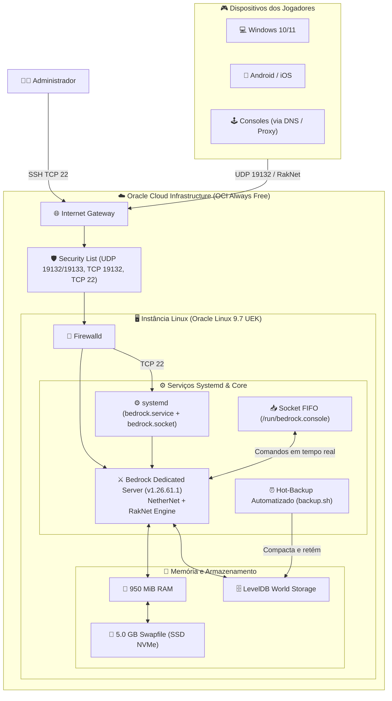
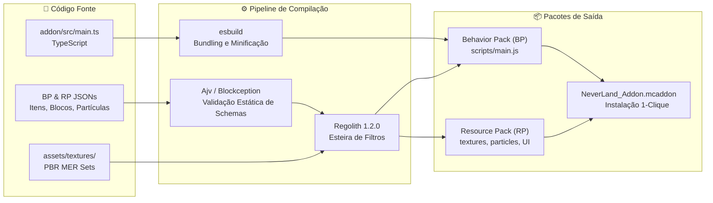
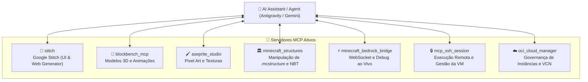

<div align="center">

# ⚔️ Never Land — Minecraft Bedrock Ecosystem

### Servidor Dedicado de Alta Performance & Add-on Moderno em TypeScript

**Minecraft Bedrock Edition 1.21+ • Render Dragon PBR • Oracle Cloud Infrastructure • Model Context Protocol (MCP)**

---

[](https://www.minecraft.net/)
[](https://www.typescriptlang.org/)
[](https://www.oracle.com/cloud/)
[](https://esbuild.github.io/)
[](https://bedrock-dot-dev.github.io/regolith/)
[](https://modelcontextprotocol.io/)

</div>

---

## 📑 Sumário Interativo

- [🌟 Visão Geral do Projeto](#-visão-geral-do-projeto)
- [🏛️ Arquitetura Integrada](#️-arquitetura-integrada)
  - [Topologia de Nuvem & Servidor BDS](#topologia-de-nuvem--servidor-bds)
  - [Esteira de Compilação do Add-on](#esteira-de-compilação-do-add-on)
- [📦 Módulos do Repositório](#-módulos-do-repositório)
- [🎮 Recursos do Add-on & UI](#-recursos-do-add-on--ui)
  - [Fusão Colourful Containers + Ty-el's UI](#fusão-colourful-containers--ty-els-ui)
  - [Render Dragon & Texturização PBR (MER)](#render-dragon--texturização-pbr-mer)
- [🚀 Instalação e Desenvolvimento Local](#-instalação-e-desenvolvimento-local)
  - [Pré-requisitos](#pré-requisitos)
  - [Scripts Disponíveis](#scripts-disponíveis)
- [☁️ Administração e Operação do Servidor](#️-administração-e-operação-do-servidor)
  - [Especificações da Instância](#especificações-da-instância)
  - [Controle via Systemd e Console FIFO](#controle-via-systemd-e-console-fifo)
  - [Interface Gráfica de Controle (GUI)](#interface-gráfica-de-controle-gui)
- [🤖 Ecossistema de Ferramentas MCP](#-ecossistema-de-ferramentas-mcp)
- [📚 Referências e Links Oficiais](#-referências-e-links-oficiais)
- [📄 Licença e Créditos](#-licença-e-créditos)

---

## 🌟 Visão Geral do Projeto

O ecossistema **Never Land** une infraestrutura de nuvem resiliente, desenvolvimento moderno de Add-ons para Minecraft Bedrock e automação assistida por IA:

1. **Servidor Dedicado (BDS)**: Operação contínua 24/7 na camada *Always Free* da **Oracle Cloud Infrastructure (OCI)** com swap contíguo de 5GB, controle granular via **systemd**, rotina de hot-backup e gerenciamento via socket FIFO (`mc.py`).
2. **Add-on Híbrido em TypeScript**: Lógica de jogo desenvolvida com `@minecraft/server` (Script API), empacotada com **esbuild** e validada estruturalmente com schemas **Ajv** e **Blockception**.
3. **Interface Avançada (VDX JSON UI)**: Fusão de **Colourful Containers BE: Mixed** e **The Ty-el's UI Pack**, adicionando abas de toque verticais híbridas (PC e Mobile), Quick Crafting 3x3 e 2x2, durabilidade numérica universal e comércio express com aldeões.
4. **Gráficos de Nova Geração**: Texturas PBR calibradas no formato MER (*Metallic, Emissive, Roughness*) compatíveis com o *Deferred Technical Preview* do **Render Dragon**.
5. **Ferramental Integrado MCP**: Servidores MCP especializados para manipulação NBT de estruturas, ponte de comunicação WebSocket, edição de pixel art via Aseprite e integração com o **Google Stitch** para geração de interfaces e protótipos web.

---

## 🏛️ Arquitetura Integrada

### Topologia de Nuvem & Servidor BDS



### Esteira de Compilação do Add-on



---


## 📦 Módulos e Estrutura do Repositório

O projeto é organizado de forma modular e declarativa para manter alta legibilidade, separando pacotes do jogo, código-fonte, automações de servidor e ferramental de IA:

```text
├── docs/                         # 📚 Documentação Técnica e Operacional Completa
│   ├── DOCUMENTACAO_SERVIDOR.md  # Manual completo de operação do BDS na OCI
│   ├── GUIA_OPERACIONAL.md       # Relatório de implantação, entrega e walkthrough
│   ├── PLANO_MESTRE_ARQUITETURA.md # Plano mestre de arquitetura e desenvolvimento
│   └── ESPECIFICACAO_INTERFACE_UI.md # Especificações de interface (ColourfulC + Ty-el's)
│
├── addon/                        # 🎮 Desenvolvimento do Add-on Minecraft Bedrock
│   ├── src/                      # Código-fonte TypeScript nativo (main.ts)
│   ├── behavior_pack/            # Behavior Pack unificado (manifest, blocks, items, scripts)
│   │   ├── blocks/               # Definições de blocos customizados
│   │   ├── items/                # Definições de itens customizados
│   │   ├── scripts/              # Bundle JavaScript compilado pelo esbuild
│   │   └── manifest.json         # Manifesto oficial do Behavior Pack
│   ├── resource_pack/            # Resource Pack unificado (manifest, animations, particles, texts, textures)
│   │   ├── animations/           # Animações Molang para entidades
│   │   ├── particles/            # Efeitos de partículas Bedrock
│   │   ├── texts/                # Dicionários de localização (pt_BR.lang)
│   │   ├── textures/             # Mapeamentos e atlas de texturas
│   │   └── manifest.json         # Manifesto oficial do Resource Pack
│   └── assets/                   # Assets brutos, texturas PBR MER e modelos 3D
│       └── textures/test/        # Texturas de teste (Albedo, MER, Normal maps)
│
├── Server/                       # ☁️ Servidor Bedrock & Infraestrutura de Nuvem (OCI Always Free)
│   ├── systemd/                  # Serviços Linux (bedrock.service, bedrock.socket, mc, mc.py)
│   ├── scripts_automacao/        # Scripts de automação, backup e instalação (backup.sh, deploy, etc.)
│   ├── auditoria_diagnostico/    # Diagnóstico, inspeção NBT e status de packs do BDS
│   ├── painel_gui/               # Painel Desktop de Gestão (mc_gui.py, assets e spec)
│   └── vm_credentials/           # (Protegido/Gitignore) Chaves SSH e IPs da VM
│
├── site/                         # 🌐 Portal Web Oficial do Servidor (https://neverland-bedrock.vercel.app)
│   ├── index.html                # Aplicação web estática com Tailwind CSS e Voxel Dark Theme
│   ├── vercel.json               # Configurações de rotas limpas e cache estático
│   ├── README.md                 # Documentação técnica do portal e guia de execução
│   └── assets/images/            # Imagens do reino e capturas passo a passo para o tutorial
│
├── tests/                        # 🧪 Baterias de Testes e Validação Empírica
│   ├── integridade_uidx/         # Testes de integridade de layout, quick craft e durabilidade
│   └── testes_empiricos/         # Testes empíricos adversariais e sensibilidade a mutações
│
├── tools/                        # 🛠️ Ferramentas, Utilitários e Servidores MCP
│   ├── utilitarios/              # Scripts de suporte (pbr_generator.py, validate_addon.js)
│   ├── aseprite-mcp-studio/      # (Submódulo MCP) Pixel Art Studio
│   ├── blockbench-mcp/           # (Submódulo MCP) Modelagem 3D
│   ├── minecraft-bedrock-mcp/    # (Submódulo MCP) Ponte WebSocket
│   ├── minecraft-structure-mcp/  # (Submódulo MCP) Parser NBT / .mcstructure
│   ├── pixel-mcp/                # (Submódulo MCP) CLI de Pixel Art
│   └── regolith/                 # (Submódulo MCP) Compilador Bedrock
│
├── .github/workflows/            # Automações de CI/CD (GitHub Actions para compilação Regolith)
├── .vscode/settings.json         # Mapeamento oficial de schemas Blockception para autocompletion
├── config.json                   # Configuração de perfis do compilador Regolith
├── esbuild.config.js             # Configuração de bundling rápido para TypeScript
├── package.json                  # Dependências e scripts npm (@minecraft/server, esbuild, TypeScript)
├── tsconfig.json                 # Configuração estrita do compilador TypeScript
└── requirements.txt              # Dependências Python para ferramentas e servidores MCP
```

---

## 📑 Documentação Detalhada

Toda a documentação aprofundada foi centralizada na pasta [`docs/`](file:///a:/BackupDesktopFileBruno/Estudos/Projetos-pessoais/Minecraft%20Server/docs):

- **[Manual Operacional do Servidor](file:///a:/BackupDesktopFileBruno/Estudos/Projetos-pessoais/Minecraft%20Server/docs/DOCUMENTACAO_SERVIDOR.md)**: Guia completo de administração, rede, firewall duplo, systemd, swap e rotina de hot-backup.
- **[Guia Operacional e Relatório de Implantação](file:///a:/BackupDesktopFileBruno/Estudos/Projetos-pessoais/Minecraft%20Server/docs/GUIA_OPERACIONAL.md)**: Ficha técnica da instância, auditorias de entrega dos marcos M1 a M5 e guia de conexão multiplataforma.
- **[Plano Mestre de Arquitetura](file:///a:/BackupDesktopFileBruno/Estudos/Projetos-pessoais/Minecraft%20Server/docs/PLANO_MESTRE_ARQUITETURA.md)**: Arquitetura do ecossistema híbrido, desenvolvimento assistido por IA e governança de BDS.
- **[Especificação de Interface UI](file:///a:/BackupDesktopFileBruno/Estudos/Projetos-pessoais/Minecraft%20Server/docs/ESPECIFICACAO_INTERFACE_UI.md)**: Detalhes da fusão Colourful Containers BE + Ty-el's UI Pack, contratos de interface e bindings UIDX.

---

## 🎮 Recursos do Add-on & UI

### Fusão Colourful Containers + Ty-el's UI

A interface unifica a elegância visual do **Colourful Containers BE** com a ergonomia funcional do **The Ty-el's UI Pack**:

<details>
<summary><b>🔍 Clique para expandir a tabela de recursos da UI</b></summary>
<br>

| Funcionalidade | Descrição | Status | Arquivo Alvo |
| :--- | :--- | :---: | :--- |
| **Aba Lateral Vertical** | Painel compacto com botões de alternância `Normal`, `Auto Place` e `Drop Place` funcional em PC e Mobile | ✅ Ativo | `vdx/ui_data/container/_modules/container_touch_buttons.uidx` |
| **Desbloqueio Híbrido** | Remoção da trava `$touch_ref_buttons: "$touch"`, habilitando botões para mouse, toque e controle | ✅ Ativo | `vdx/ui_data/container/_modules/container_item.uidx` |
| **Quick Crafting 3x3** | Botão integrado na seta da bancada com tooltip `Fabricar Tudo` acionando `crafting_output_tertiary` | ✅ Ativo | `vdx/ui_data/container_mixed/crafting_table.uidx` |
| **Quick Crafting 2x2** | Atalho de fabricação rápida no inventário com suporte a múltiplos itens | ✅ Ativo | `vdx/ui_data/container_mixed/inventory.uidx` |
| **Durabilidade Numérica** | Rótulo numérico preciso sobreposto em ferramentas/armaduras danificadas e no cursor | ✅ Ativo | `vdx/ui_data/_common/durability_bar.uidx` |
| **Troca Express com Aldeões** | Botão de comércio contínuo cobrindo a seta com validação dinâmica de estoque | 📋 Planejado | `vdx/ui_data/container/villager.uidx` |

</details>

---

### Render Dragon & Texturização PBR (MER)

O projeto suporta o *Deferred Technical Preview* do Bedrock Engine, utilizando conjuntos de textura com padrão MER:

```json
{
  "format_version": "1.21.30",
  "minecraft:texture_set": {
    "color": "cristal",
    "metalness_emissive_roughness": "cristal_mer",
    "normal": "cristal_normal"
  }
}
```

- **Canal Vermelho (R)**: *Metallic* (0 = Dielétrico, 255 = Metálico puro).
- **Canal Verde (G)**: *Emissive* (intensidade de autoiluminação no escuro).
- **Canal Azul (B)**: *Roughness* (0 = Especular/Espelhado, 255 = Rugoso/Fosco).

---

## 🚀 Instalação e Desenvolvimento Local

### Pré-requisitos

- **Node.js**: v20.x ou superior.
- **Python**: 3.11 ou superior (com ambiente virtual configurado).
- **Minecraft Bedrock Edition**: 1.21.x ou superior com *Recursos Experimentais* habilitados.

### Scripts Disponíveis

Clone o repositório e instale as dependências:

```bash
# Instalação das dependências Node.js
npm install

# Instalação das dependências Python
pip install -r requirements.txt
```

Execução dos comandos de desenvolvimento:

```bash
# Compilação única do TypeScript via esbuild
npm run build

# Observação contínua de alterações com recompilação automática
npm run watch

# Checagem estática de tipos sem emissão de código
npm run type-check

# Validação estrutural de manifests e componentes do Add-on
npm run validate
```

---

## ☁️ Administração e Operação do Servidor

### Especificações da Instância

| Parâmetro | Valor |
| :--- | :--- |
| **Provedor** | Oracle Cloud Infrastructure (OCI Always Free) |
| **Forma (Shape)** | `VM.Standard.E2.1.Micro` (1 OCPU AMD EPYC, 2 vCPUs) |
| **Sistema Operacional** | Oracle Linux Server 9.7 (Kernel UEK 6.12.0 x86_64) |
| **Memória RAM / Swap** | 950 MiB RAM Física + **5.0 GB Swapfile Contíguo** em SSD NVMe |
| **Porta Principal (IPv4)** | `19132 UDP` (Gameplay RakNet) / `19132 TCP` (NetherNet Signaling) |
| **Porta Alternativa (IPv6)** | `19133 UDP` |

### Controle via Systemd e Console FIFO

<details>
<summary><b>🛠️ Clique para ver os comandos de console e terminal Linux</b></summary>
<br>

O servidor opera sob a unidade **systemd** `bedrock.service` com injeção segura de comandos via `/run/bedrock.console`:

```bash
# Verificar status detalhado e uso de memória
sudo systemctl status bedrock.service

# Reiniciar o servidor de forma limpa
sudo systemctl restart bedrock.service

# Acompanhar logs do console em tempo real
journalctl -u bedrock.service -f -n 100

# Executar comandos no console do Minecraft via utilitário mc
mc status
mc say "Aviso: Manutenção programada em 10 minutos!"
mc list
mc op "NomeDoJogador"

# Disparar rotina manual de backup
sudo /opt/bedrock/backup.sh
```

</details>

---

### Interface Gráfica de Controle (GUI)

O projeto conta com um painel de controle para desktop desenvolvido em Python ([`Server/painel_gui/mc_gui.py`](file:///a:/BackupDesktopFileBruno/Estudos/Projetos-pessoais/Minecraft%20Server/Server/painel_gui/mc_gui.py)), que permite:

- Visualizar o status online e latência do servidor.
- Enviar comandos administrativos com 1 clique (kick, ban, whitelist, tp, give).
- Reiniciar o serviço e disparar rotinas de backup sem abrir o terminal SSH.
- Compilar standalone via PyInstaller através de [`Server/painel_gui/build_mc_gui.bat`](file:///a:/BackupDesktopFileBruno/Estudos/Projetos-pessoais/Minecraft%20Server/Server/painel_gui/build_mc_gui.bat).

---

## 🤖 Ecossistema de Ferramentas MCP

O projeto utiliza servidores [Model Context Protocol (MCP)](https://modelcontextprotocol.io/) para conectar modelos de linguagem às ferramentas de engenharia:



---

## 📚 Referências e Links Oficiais

### 🎮 Minecraft Bedrock & Desenvolvedor Oficial

- [Minecraft Bedrock Script API — Documentação Oficial Microsoft](https://learn.microsoft.com/en-us/minecraft/creator/scriptapi/)
- [Minecraft Creator Portal — Guias e Tutoriais Mojang](https://learn.microsoft.com/en-us/minecraft/creator/)
- [Download Oficial do Bedrock Dedicated Server (BDS)](https://www.minecraft.net/en-us/download/server/bedrock)
- [Render Dragon & Deferred Lighting Technical Preview (PBR / MER)](https://learn.microsoft.com/en-us/minecraft/creator/documents/deferredlighting)
- [Mecanismo de Pacotes e Manifests no Bedrock](https://learn.microsoft.com/en-us/minecraft/creator/documents/packaginganaddon)

### 🧩 UI Engine, Schemas & Comunidade

- [Blockception Bedrock JSON Schemas (GitHub)](https://github.com/Blockception/Minecraft-bedrock-json-schemas)
- [Bedrock Wiki — Enciclopédia Técnica da Comunidade](https://wiki.bedrock.dev/)
- [Bedrock.dev — Referência de Componentes e Documentação](https://bedrock.dev/)
- [VDX Framework & Colourful Containers por CrisXolt](https://github.com/CrisXolt)
- [The Ty-el's UI Pack (MCPEDL)](https://mcpedl.com/the-ty-els-ui-pack/)
- [Regolith — Compilador e Esteira de Filtros para Add-ons](https://bedrock-dot-dev.github.io/regolith/)

### 🛠️ Modelagem 3D & Texturização

- [Blockbench — Modelagem 3D e Animações para Minecraft](https://www.blockbench.net/)
- [Aseprite — Software de Animação e Pixel Art](https://www.aseprite.org/)
- [Guia PBR Textures para Render Dragon](https://wiki.bedrock.dev/visuals/pbr.html)

### ☁️ Infraestrutura, Linux & Automação

- [Documentação Oficial da Oracle Cloud Infrastructure (OCI)](https://docs.oracle.com/en-us/iaas/)
- [Guia do Administrador do Oracle Linux 9](https://docs.oracle.com/en/operating-systems/oracle-linux/9/)
- [Documentação Oficial do Systemd (systemd.io)](https://systemd.io/)
- [Kernel Linux Cgroups v2 & Gerenciamento de Memória](https://www.kernel.org/doc/html/latest/admin-guide/cgroup-v2.html)

### 🤖 Inteligência Artificial & Tooling Moderno

- [Especificação Oficial do Model Context Protocol (MCP)](https://modelcontextprotocol.io/)
- [Google Stitch — Plataforma de Prototipagem e UI com IA](https://stitch.withgoogle.com/)
- [TypeScript — Documentação da Linguagem](https://www.typescriptlang.org/docs/)
- [esbuild — Bundler JavaScript/TypeScript de Alta Performance](https://esbuild.github.io/)
- [Ajv JSON Schema Validator](https://ajv.js.org/)

---

## 📄 Licença e Créditos

- **Never Land Addon & Scripts**: Desenvolvido pela equipe Never Land sob licença proprietária/MIT para uso do servidor.
- **Colourful Containers BE: Mixed**: Criado originalmente por **CrisXolt** sob licença Creative Commons Attribution.
- **The Ty-el's UI Pack**: Criado por **The Ty-el**.
- **Minecraft**: Marca registrada da **Mojang Studios / Microsoft Corporation**. Este projeto não possui afiliação oficial com a Mojang ou Microsoft.
